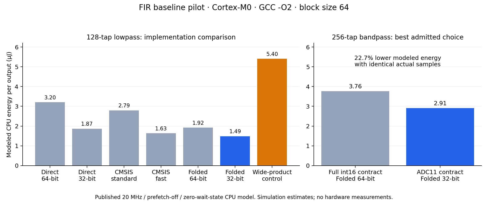

# Professor discussion proposal

**Working title:** Input-Range Contracts and Arithmetic Width in Energy-Efficient Fixed-Point FIR Software

**Compiler explanation, 20 October 2026:** The bounded review of the two existing block1 direct binaries is complete with partial attribution. GCC15 retains and rotates history samples through stack slots before testing the output-loop exit. Its extra executed stack transfers account for all additional RAM traffic and 85.02% of the modeled CPU-energy increase over GCC10. The residual instruction/branch costs and responsible compiler pass remain unresolved. Independent numerical, binary/control-flow and value-flow checks support this fixed-fixture explanation; no new target measurements were made. The result strengthens the empirical account without establishing a new algorithm or physical savings. [Final explanation decision](research/fir-sharing-probe/explanation-check/final-decision.md), [paper outline](research/fir-sharing-probe/explanation-check/paper-outline.md).

**Latest result, 20 October 2026:** The fixed fairness check is complete. An exact direct implementation with two int32 partial sums and an int64 reduction wins both GCC 10 configurations; demand Hcub wins both GCC 15 configurations. Against this stronger direct control, Hcub costs 4.33%/5.00% more modeled CPU energy with GCC 10 (blocks 1/64), and 24.06%/5.23% less with GCC 15. Ordinary transposition wins only GCC 15/block1. Four timed and two signed-edge binaries passed 1,750 output comparisons; the independent checker admitted all four timed rows, and arithmetic/emitted code were reviewed. Continue as a bounded empirical study of arithmetic fairness and compiler-dependent representation costs. A new FIR algorithm and substantial field novelty remain unestablished. [Completed comparison and decision](research/fir-sharing-probe/independent-check/join-review.md).

**Follow-up, 20 October 2026:** A bounded exact coefficient-sharing probe now supplies a sharper empirical direction: how suffix-state widths and graph emission affect transposed FIR software versus strong direct/folded/library controls. Across three fixed designs and two compilers, transposed kernels win 12/24 modeled-energy groups and lose the other 12. Width and same-graph controls explain important gains and failures. This supports developing the empirical paper; it does not establish a new FIR algorithm. See [the completed probe and recommended direction](research/fir-sharing-findings.md). The earlier study below remains its experimental foundation.

**Status, 19 October 2026:** The baseline and bounded held-out validation are implemented and verified. Technical feasibility is strong, but **the results do not yet establish meaningful field novelty or a new FIR algorithm**. The fixed arithmetic-based policy fails on stronger library controls: after a documented odd-filter padding correction, it selects the modeled-energy winner in 77/108 groups. Known unrolling, state-management and compiler effects explain the main failures. Present this as a reproducible empirical investigation with an explicit novelty boundary. See the [new validation findings](research/fir-selection-validation-findings.md) and [critical novelty audit](research/fir-current-novelty-audit.md).

**Scope:** FIR only; simulator-only college research; publication optional. Conclusions concern a stated CPU model, not physical board energy. The earlier exact-skipping proposal is preserved in [the archive](research/archive/professor-topic-proposal-exact-skipping.md).

## The question

> How do guaranteed input ranges and exact intermediate-arithmetic requirements change the most efficient valid implementation of a fixed-point FIR filter?

The reference computation, coefficients and final quantizer remain fixed. Every implementation must emit the same complete output sequence. A fast implementation that can overflow for an admitted input is excluded, even when the particular benchmark signal is small.

This changes the study from a simple timing/energy comparison into a controlled investigation of **which implementations are legal under a computation contract, and what those constraints cost in compiled execution**.

## A pitch for the professor

> Embedded FIR software often offers several implementations that appear to compute the same filter. Their validity and cost depend on intermediate arithmetic: an accumulator may overflow, a symmetry pre-addition may require an extra bit, or a wider C expression may invoke software multiplication. We propose to study these interactions while preserving every output bit. We will prove the input/coefficient conditions under which each implementation is valid, verify compiled target outputs, and measure complete-stream instruction and memory events. Those events support an explicit architectural timing estimate and a published configuration-specific CPU-energy model. The intended contribution is a reproducible characterization of when arithmetic contracts change implementation choices, with explanations at the generated-code level.

## Why this is worth investigating

The baseline already supplies two concrete observations:

1. **A guarantee can change the best valid candidate without changing the actual samples.** For our 256-tap bandpass filter, full-int16 inputs can produce an accumulator exceeding int32. An ADC11 guarantee safely admits a folded int32 implementation. With identical actual ADC samples, the best admitted candidate's modeled CPU energy falls by 22.74% at `-O2`, block64; the corresponding `-Os` result is 23.87%.
2. **Fewer source products can mean more target multiplies.** On this pinned toolchain, the general wide-product folded control performs half the logical FIR products but executes three times as many MUL instructions as the unfolded direct control. Software wide-multiply helpers explain this. A product-range-certified folded implementation avoids those helpers.

These observations are bounded to the tested code, compiler and model. They do not establish that these broad effects are new. The wide-product control is diagnostic; it must not be used as the sole weak baseline for claiming an improvement.

## What is already implemented

Seven alternatives are compared: direct int64, direct int32, folded int64 with proven int32 products, folded int32, a general wide-product folded control, and the standard/fast Q15 routines from unmodified CMSIS-DSP v1.14.4. The library uses its default scalar path. Its fast routine is included only where the same no-overflow proof holds.

Six symmetric lowpass/bandpass filters use 64,128,256 taps. Block sizes are 1,16,64; each finite stream has 257 samples, including a short final block. Arm GCC 10.3.1 targets Cortex-M0 Thumb with `-O2` and `-Os`, without LTO. Code/coefficients reside in Flash; samples, state and outputs reside in SRAM. The actual ADC stream is shared across the two input contracts. A separate full-range edge stream checks signed and saturation behavior.

The measurement includes recurring state copies, convolution, output writes, stream-loop control and calls/returns. Fixture initialization, input acquisition and printing are outside the region.

**Verification:** Five host test methods pass with undefined-behavior sanitization; eight assembly counter/timing-model checks pass; 486 distinct target binaries produce 124,902 output comparisons with zero mismatches and correct retained history. These reuse 3,084 reference output positions. There are 720 valid contract rows and 36 explicitly excluded unsafe rows; shared contract traces are not independent runs.

See [the detailed findings](research/fir-baseline-findings.md), [reproduction instructions](research/fir-baseline/README.md), [raw result table](research/fir-baseline/results.csv) and [derived arithmetic certificates](research/fir-baseline/analysis.json).

## Numerical correctness and admission

The output is `clip_int16(floor(Σh[i]x[n-i]/32768))`, using exact products and sums before final quantization. No coefficients, samples, outputs or final precision are dropped.

If every admitted input has absolute value at most M, a sufficient condition for all int32 accumulation prefixes is:

`M * Σ|h[i]| <= INT32_MAX`.

Symmetry folding additionally requires a wide pre-addition and a proof that its product fits the chosen width. When the narrower product proof fails, a genuinely wide product is required. These are existing arithmetic principles, not proposed new theorems.

For bandpass256, `Σ|h[i]|=74258`. A full-range coefficient-sign-aligned window gives an exact sum of 2433249006, greater than INT32_MAX. Under ADC11, the absolute bound is only 76040192. Thus the change in admissible accumulator width has a mathematical basis beyond testing a few small inputs.

## Timing and energy claims

The simulator source audit found raw timing errors, including POP and branch costs. Therefore raw ticks are retained only as diagnostics. For the emitted instruction subset, an independently specified Arm zero-wait-state table estimate is checked with assembly programs. It is not hardware-validated STM32 timing or a reproduced published timing reconstruction.

CPU-energy estimates use Nikov et al., Table 2, explicitly **20 MHz, prefetch OFF, zero wait states**, mapped to verified non-MUL/MUL instruction, branch and data-access events. No physical measurements were collected. The published model's validation error is not a guaranteed error bound for our implementation comparisons. [Primary energy-model paper](https://arxiv.org/html/2301.12806v1), [simulator audit](research/fir-simulator-audit.md).

For the 128-tap lowpass, `-O2`, block64, illustrative modeled energy/output is 2.792 µJ for CMSIS standard, 1.634 µJ for safely admitted CMSIS fast, and 1.487 µJ for folded int32. These are model estimates for complete finite streams, not universal production-library comparisons.

## Intended contribution and originality boundary

The intended contribution is **new controlled empirical evidence and explanations of correctness-constrained FIR selection**, supported by executable artifacts, arithmetic admission conditions and verified target outputs. This is a research-paper direction because it produces and analyzes new experimental evidence; collecting literature alone would be a review.

The following are already established and cannot be claimed as our inventions:

| Existing work | What it establishes |
|---|---|
| Ménard and Sentieys, [DSP Code Generation with Optimized Data Word-Length Selection](https://link.springer.com/chapter/10.1007/978-3-540-30113-4_16), 2004 | Processor-aware fixed-point word-length/code-generation optimization; the broad specialization problem is old. |
| [MathWorks FIR precision rules](https://www.mathworks.com/help/dsp/ug/fixed-point-precision-rules-for-avoiding-overflow-in-fir-filters.html) | Coefficient/input-range bounds and exact accumulator sizing. |
| [Arm CMSIS-DSP FIR](https://arm-software.github.io/CMSIS-DSP/latest/group__FIR.html) | Production FIR implementations with different accumulation behavior and explicit numeric contracts. |
| [Nikov et al.](https://arxiv.org/html/2301.12806v1) | The simulator/event-model foundation and configuration-specific energy models reused here. |

A new benchmark is not automatically a meaningful research contribution. Before asserting originality, establish which interaction or result the closest FIR/compiler studies leave unresolved and why our evidence changes implementation guidance. No first-of-kind claim is supported yet. [Literature screen](research/fir-next-direction-screen.md).

## Validation result and next decision

**Completed decision gate:** A fixed pilot-derived rule was evaluated on six new task-motivated designs and GCC 10.3.1/15.2.Rel1. A separate post-evaluation correction adds zero-padded CMSIS comparisons for the odd filter. Together, 570 binaries produce 292,410 matching target outputs, with correct history and canaries. The policy's mean/worst modeled-energy overhead versus the strongest valid tested candidate is 5.25%/51.83%. The substantial failures currently have established implementation explanations; this is useful evidence, not secured field novelty. The ADC11 guarantee is applied only to unshifted stored samples. [Protocol](research/fir-validation-protocol.md), [complete findings](research/fir-selection-validation-findings.md).

**Current decision:** Stop expanding the matrix merely to claim originality. Prepare the empirical argument and counterexamples for the professor. If a clearly new algorithm or unresolved field-level issue is required, this stage has not demonstrated one. Any future improved policy must be evaluated on a fresh set rather than scored as held out on these now-inspected cases.

1. Present the fixed prediction, counterexamples and generated-code explanations alongside the closest FIR and precision-selection literature. State clearly which observations are new measurements of established mechanisms.
2. Keep the original held-out evaluation separate from post-evaluation causal analysis and the padding correction. The cheapest candidate means cheapest **within the tested set**.
3. If a stronger originality claim is required, first state a concrete unresolved issue that existing FIR methods fail to address. Do not treat a tuned replacement rule or more benchmark rows as that issue.

The timing-estimate and modeled-energy winners agree in all 108 **original pilot** groups. With stronger controls in the separate validation and padding supplement they differ in 39/108 groups, but the modeled-energy penalty of choosing the timing winner is only approximately 0.020–2.001%. These close, physically unvalidated model rankings do not establish a robust time–energy proxy-failure contribution. The original quantization-skipping method is also not the recommended main method.

## Earlier validation pitch (before the final baseline check)

> We completed a reproducible exact-output FIR experiment and tested a fixed arithmetic-based selection rule on six new designs and two compilers. With stronger library controls it selects the modeled-energy winner in 77/108 groups; library and state-management effects explain important failures. We can present a controlled empirical study and reproducible artifact. We have not yet established a new FIR algorithm or a substantial field-level novelty claim, and our energy figures remain model estimates.

## What to tell the professor now

> We completed the missing arithmetic-fairness comparison. Narrow direct partial sums reverse the apparent transposed advantage with GCC 10, while Hcub retains an advantage with GCC 15. The corrected result is compiler-dependent and has explicit code, state and frame tradeoffs. This supports a reproducible empirical project about fair FIR implementation comparisons; it does not establish a new algorithm or physical energy savings.
